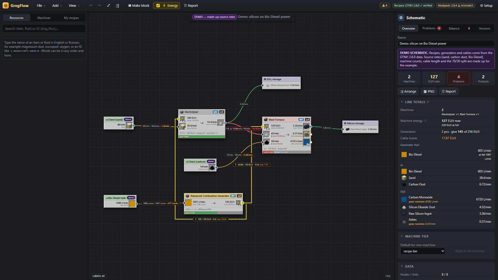
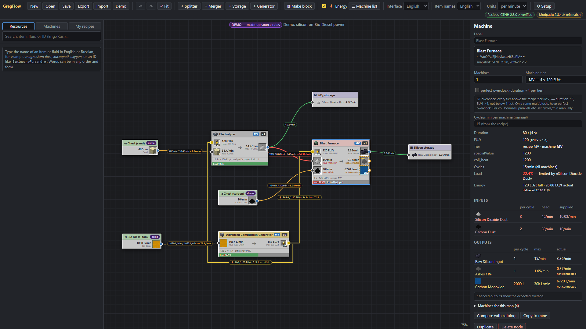
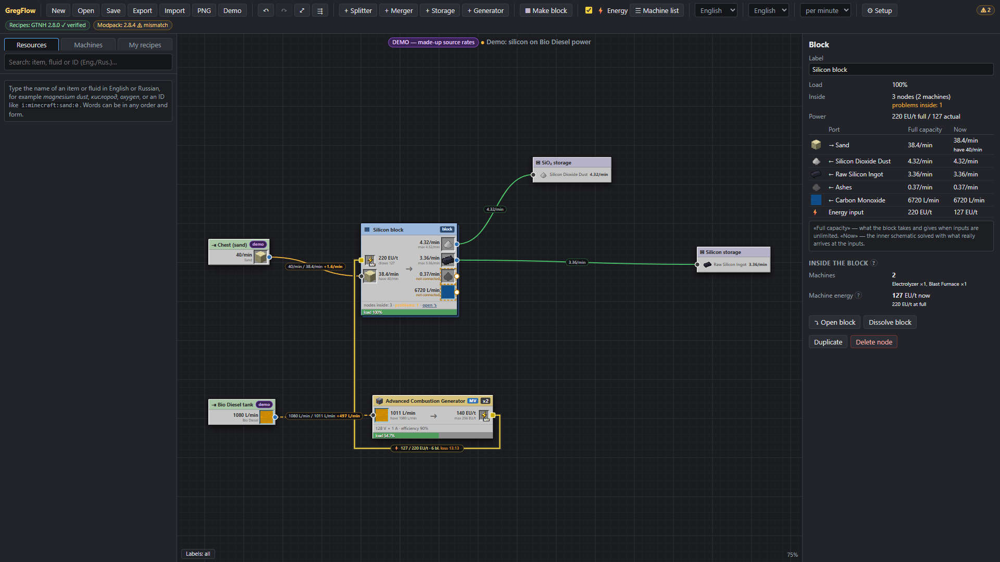
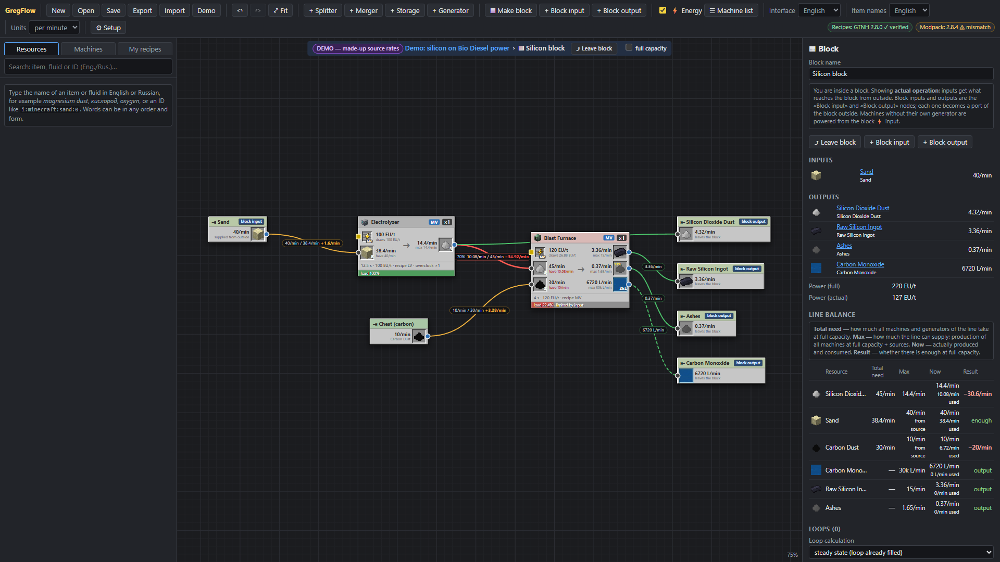
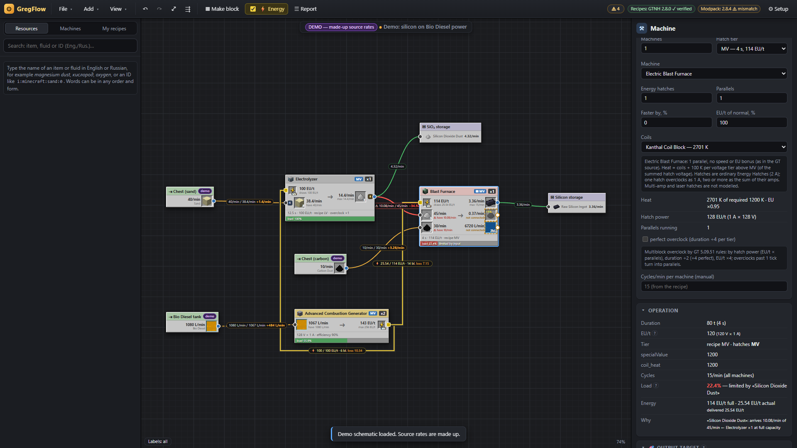
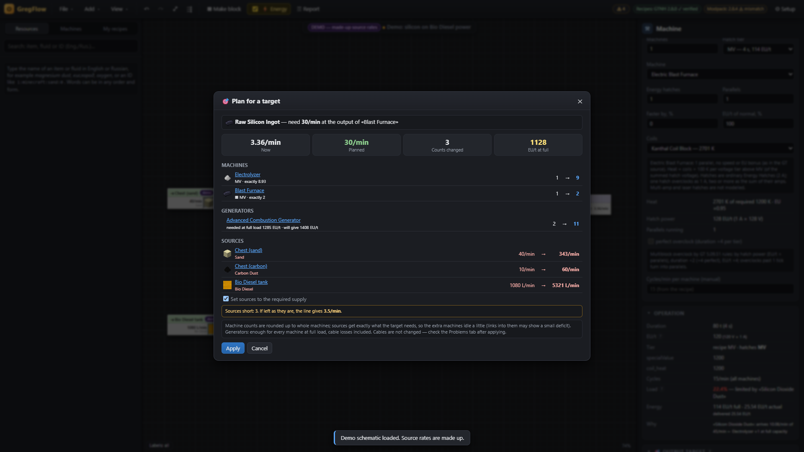
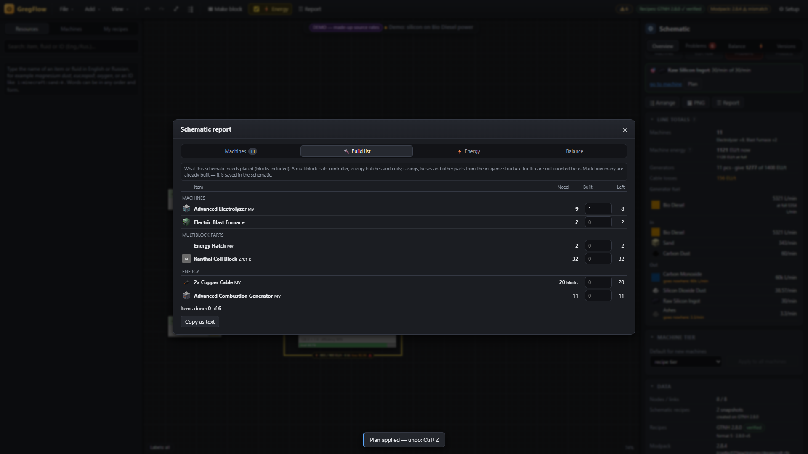

# GregFlow

**English** · [Русский](README.ru.md)

**GregFlow** is a production line planner for **GregTech: New Horizons** (Minecraft 1.7.10). Build a line from real
GTNH recipes on a canvas, the way NEI shows them, and see on every link how much is needed, how much
arrives, and where the shortages and surpluses are. It also covers energy (generators, cables,
losses), recycling loops and blocks (a node made of nodes). The interface is in English or Russian.

It runs on your own computer in the browser. Nothing is installed into Minecraft, and your game
files are never changed.



<sub>Demo schematic: the recipes, generators and cables are real GTNH 2.8.0 data; the source rates, machine counts and cable lengths are made up for the example.</sub>

<table>
<tr>
<td width="33%"><a href="docs/img/machine.png"></a><br><sub>Select a node to see what it needs, gets and makes, and what limits it.</sub></td>
<td width="33%"><a href="docs/img/block.png"></a><br><sub>A block: several nodes combined into one, with its own inputs, outputs and ⚡ input.</sub></td>
<td width="33%"><a href="docs/img/block-inside.png"></a><br><sub>Inside the block, solved with what actually reaches its inputs.</sub></td>
</tr>
<tr>
<td width="33%"><a href="docs/img/multiblock.png"></a><br><sub>A multiblock: energy hatches, parallels and coil heat, with GT's own overclock rules.</sub></td>
<td width="33%"><a href="docs/img/plan.png"></a><br><sub>Plan for a target: machine, generator and source numbers for 30 ingots/min.</sub></td>
<td width="33%"><a href="docs/img/build.png"></a><br><sub>Build list: exact machine blocks, hatches, coils, generators and cable, with what is left.</sub></td>
</tr>
</table>

---

## Install and start (no programming needed)

### Windows

1. **Download** the latest `GregFlow-….zip` from the
   [Releases page](https://github.com/Jetvac/GregFlow/releases/latest) and **unzip** it anywhere
   (for example into `Documents`).
2. **Double-click `start.bat`.**
   - If Python is missing, the window offers to install it for you (answer `Y`), or opens
     python.org. After installing, double-click `start.bat` again.
3. Your browser opens the planner. The **Setup** window appears on first start:
   - **Download recipe data** (about 30 MB, once). It is checked by SHA-256.
   - Pick the **interface language** and the language of item names.
   - Optional: **Russian item names** (about 9 MB).
   - Optional: your **Minecraft folder**. Click «Find automatically» (Prism, MultiMC, CurseForge,
     ATLauncher…) or paste the path of the folder that contains `mods` and `config`. The planner only
     **reads** it: the modpack version, the GregTech cable table and mod translations.
4. Keep the black console window open while you use the planner. Close it to stop.

Next time, just double-click `start.bat`. Your schematics are saved in the `projects` folder.

### Linux / macOS

Install Python 3.9 or newer (`sudo apt install python3`, or from python.org on macOS), then run
`./start.sh`. On macOS you can double-click `start.command`.

#### Linux server: run as a service

One command installs GregFlow as a systemd service. It downloads the recipe data, starts the
planner, sets it to start at boot and prints the address to open:

```bash
./start.sh install
```

By default the planner listens only on the server itself, and the command prints an SSH tunnel to
reach it from your computer:

```bash
ssh -N -L 8765:127.0.0.1:8765 user@server
```

Then open http://127.0.0.1:8765/ in your browser.

To open it straight from other computers on your network, install it with `--lan`. **There is no
login**: anyone who can reach the port can view and edit the schematics, so use this only on a
trusted network or VPN.

```bash
./start.sh install --lan
```

| Command | What it does |
|---|---|
| `./start.sh install [--port N] [--lan \| --host ADDR] [--mc-dir PATH]` | install or reinstall the service, start it, print the address |
| `./start.sh url` | print the address again |
| `./start.sh status` · `./start.sh logs` | service state · last 100 log lines |
| `./start.sh restart` | restart, for example after an update |
| `./start.sh uninstall` | remove the service; projects and data stay |

Run `install` as your normal user. It creates a user service and enables `loginctl enable-linger`
so the service starts at boot without a login. If that step needs root, the script prints the
`sudo` command. With `sudo ./start.sh install` it creates a system service instead, which runs
as the owner of the planner folder.

### Updating

Download the new release, unzip it, and copy your `projects` folder (and `data/custom` if you made
your own recipes) from the old folder into the new one.

---

## Using it

| What | How |
|---|---|
| Layout | Top bar: «File» (new, open, save, import, export, PNG, demo), «Add» (splitter, merger, storage, generator), «View» (interface language, item names, rate units), «⚡ Energy», «☰ Report». The right panel has tabs — Overview, Problems, Balance, ⚡, Versions — and every section is a card that folds with a click on its title; the panel remembers both. |
| Find an item | Left panel → «Resources»: type a name in English or Russian, or an ID. Words can be in any order. |
| Add a machine | Open an item → «Produced by» / «Consumed by» → drag a recipe onto the canvas, or click «To canvas». |
| Connect | Drag from an output port to an input port. Compatible ports light up. Drop on empty space to get a list of matching recipes. |
| Machines per node, tier | Select a node → right panel: count, machine tier (GT overclock is applied), cycles/min for special cases. |
| **Multiblocks** | In the machine panel, «Machine» switches a node from the single block to one of the recipe's multiblocks. Set the energy hatches (count and tier), parallels and speed / EU bonuses from the machine's tooltip; for heat recipes pick the coils (Electric Blast Furnace) or enter the heat. Overclocks, parallels, the heat discount and heat overclocks follow GregTech 5.09.51 exactly; a furnace that is too cold is reported and stops. |
| **Plan for a target** | Machine panel → «🎯 Output target»: choose the product and how much per minute → «Plan the line». A window shows the new machine count for every step, generator counts and how much each source must supply; «Apply» changes them all at once (Ctrl+Z undoes). The target is kept: Overview shows how close the line is. |
| Split an output | Drag a second link from the same output and set a fixed share (e.g. 70%); the rest goes «auto» by demand. |
| Energy | Toggle «⚡ Energy», add a generator, connect its ⚡ to the ⚡ of machines, choose a cable and its length. |
| Line totals | Right panel → «Line totals»: machines, energy now and at full, generator output, fuel burned, what comes in and what goes out. The same totals are shown for a selected block and for any selection of nodes. «Line balance» compares what the line needs at full capacity with what it can make; click a row to outline its nodes. «☰ Report» opens a window with every machine, generator and cable and the full balance, with a copy-as-text button. |
| Problems and fixes | The «⚠ N» badge opens the «Problems» tab. Where the fix is known it is a button: «Electrolyzer: machines 1 → 5», «Generators 2 → 3», a cable that can carry the current, «+ Storage» for a loose output. Hover a red number or a load bar to see what limits it. |
| **Build list** | «☰ Report» → «🔨 Build list»: every machine block by exact item and tier, multiblock controllers with their energy hatches and coils, generators and cable. Type how many you have already placed — the list keeps track of what is left and saves it in the schematic. Copy as text is included. |
| **Bus** | «Add» → «Bus»: a shared line (for example fuel for many generators). Feed one end; drag a branch from the bus to each consumer and it leaves the bus at a right angle from the nearest point. Move it by its label, stretch it with the square at the end, turn it vertical in its properties; buses can feed each other. On any link, «Route links from this output through a bus» moves all links of that output onto a new bus in one step. A bus is calculated exactly like a splitter. Links can also be drawn as short tags: «View» → «Links as tags» (off by default) or per link. |
| Robot arm slots | GT single-block machines show small numbers next to their item slots: the slot number to set on a Robot Arm (blue — inputs, orange — outputs). The machine panel names the exact machine block at the node's tier and lists all its slots. Inputs accept an item in any input slot, so input numbers follow the recipe order; the programmed circuit has no number (automation cannot insert it). Turn the numbers off in «View». |
| Find recipes fast | Hover any icon and press **R** (recipes that make it) or **U** (recipes that use it). Favourites (☆) and recently opened items are listed under the empty search box. |
| **Blocks** | Select several nodes (Ctrl/Shift + click, or Shift + drag a frame) → «▦ Make block» (Ctrl+G). Links crossing the border become the block's inputs and outputs. Double-click a block to edit its inside, «⤴ Leave block» or Esc to go back. |
| Copy and arrange | Ctrl+C / Ctrl+V copy nodes (also into another schematic), Ctrl+D duplicates, **L** or «⇶» arranges the line left to right. Zoomed out, each card shows only its name, load and status; «Labels» (bottom left) can hide the link numbers except where there is a problem. |
| Undo / save | Ctrl+Z / Ctrl+Y, Ctrl+S saves into `projects/`, Ctrl+O opens. A ● next to the name means changes since the last save. «Versions» keeps named copies inside the schematic file. «File → Export file» downloads a file you can share, «File → PNG picture» saves a picture. |

### How it calculates

- Machine speed is `count × parallels × 20 / ticks` cycles per second. Overclocks are the ones
  GregTech 5.09.51 computes (`OverclockCalculator`): a single block overclocks once per voltage tier
  above the recipe (duration ÷2, EU/t ×4; perfect: ÷4), not below 1 tick — at 1 tick it still
  draws ×4 per overclock, as in the game. A multiblock overclocks by its hatches' power; past
  1 tick the extra overclocks become parallels. Electric Blast Furnace: heat = coils + 100 K per
  tier above MV, −5% EU per 900 K of spare heat, and a ÷4 overclock per 1800 K.
- **Plan for a target** works backwards from the target: each machine gets the count that covers
  what its consumers ask for (fixed shares included), sources are set to exactly what the line
  takes (recycled material counts), and counts are rounded up to whole machines.
- A machine's load is the lowest «supplied / needed» over its inputs (and delivered energy).
  Chanced outputs use the expected average.
- **Loops** (e.g. Mg → Chemical Reactor → MgO → Electrolyzer → Mg) are solved in the steady state:
  the loop is already filled, as in the game after the first load. If a loop returns less than it
  takes (for example 2 cells in, 1 back), the planner says which path loses what, and the loop
  goes to exactly zero instead of showing tiny leftover numbers.
- **Blocks** are exact, not an estimate: the inside is solved with what really reaches the block's
  inputs. «Full capacity» shows what it would take and give with unlimited inputs.
- **Energy**: a generator gives up to `V × A × count` and burns fuel only for what is drawn. Power
  is delivered on demand, as in a GT network: a machine that is short of materials draws less, and
  the rest goes to the other machines. Only when the generators cannot cover what the machines ask
  for is the shortage shared in proportion. A cable loses `loss per block × length` EU per amp;
  warnings for burning cables and exploding machines.

Details about data sources and the models: [docs/DATA.md](docs/DATA.md).

### Recipe version

The recipes are the verified **GTNH 2.8.0** snapshot. No verifiable export exists for 2.8.4; the
planner shows the version and warns if your modpack differs. You can import your own export
(formats 5 and 7) or add corrections in «My recipes».

---

## For developers

- Python 3.9+ standard library only, no dependencies. Plain ES modules in the browser, no build step.
- `python planner.py --help` lists console options (`--port`, `--mc-dir`, `--no-browser`,
  `--fetch-data`, `--fetch-lang`, `--check`).
- Tests: `python -m unittest discover -s tests` (needs the recipe data) and `web/tests.html` in the
  running planner for the solver.
- Layout: `server/` (HTTP API, data adapter, setup, energy tables, names), `web/js/` (`solver.js` —
  calculations, `model.js` — schematic model, `canvas.js`, `props.js`, `i18n.js` — interface strings).

## Licenses and credits

- Planner code: **MIT** — see [LICENSE](LICENSE).
- Binary format layout ported from [ShadowTheAge/gtnh](https://github.com/ShadowTheAge/gtnh) (MIT, © 2025 ShadowTheAge).
- Recipe data, names and icons: [ShadowTheAge/gtnh-data](https://github.com/ShadowTheAge/gtnh-data).
  It has no license and belongs to Mojang, the GTNH team and mod authors, so it is **not included**
  here; the planner downloads it from the original repository on your computer.
- Russian names: [GTNewHorizons/GTNH-Translations](https://github.com/GTNewHorizons/GTNH-Translations) (GPL-3.0), downloaded on demand.
- Overclock, parallel and coil heat rules ported from GT5-Unofficial 5.09.51.482 (`OverclockCalculator`, `ParallelHelper`, `MTEElectricBlastFurnace`, `HeatingCoilLevel`) — see `web/js/overclock.js`.
- Cable table values and machine slot counts (`data/gt-machine-slots.json`, made by `scripts/gt_machine_slots.py` from tag 5.09.51.482): [GregTech 5 Unofficial](https://github.com/GTNewHorizons/GT5-Unofficial) (GTNH team, LGPL-3.0).
- The screenshots in `docs/img` show item and machine icons from Minecraft, GregTech and other GTNH
  mods; those textures belong to their authors and are shown only to illustrate the planner.

Not affiliated with the GTNH team or Mojang.
