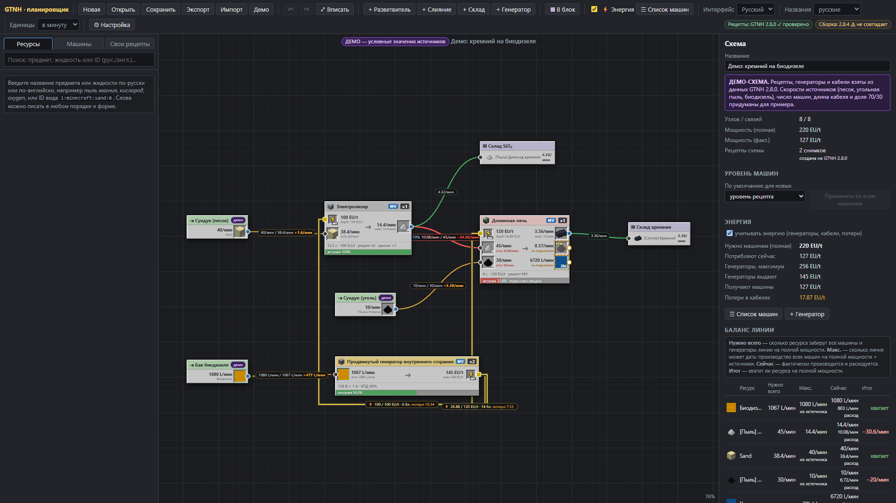
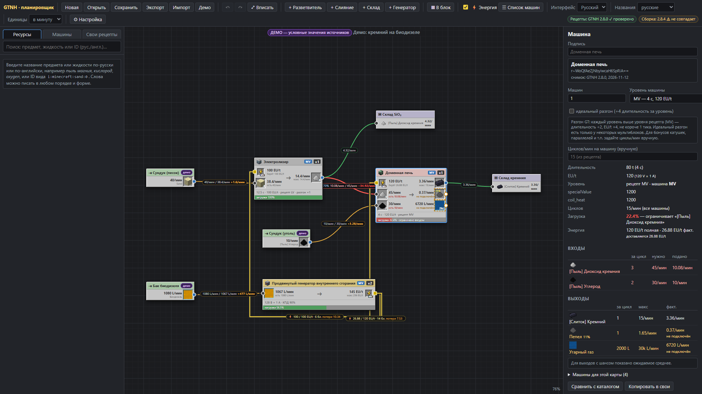
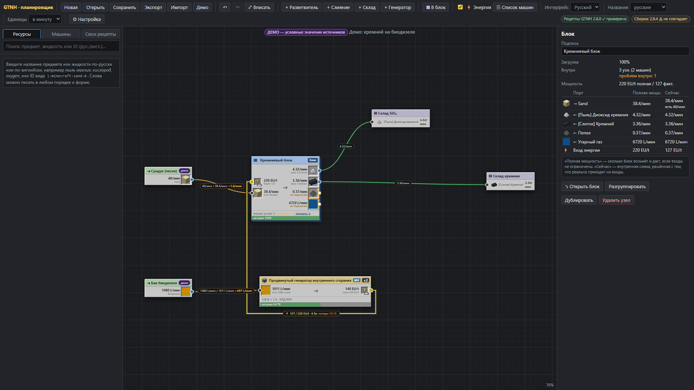
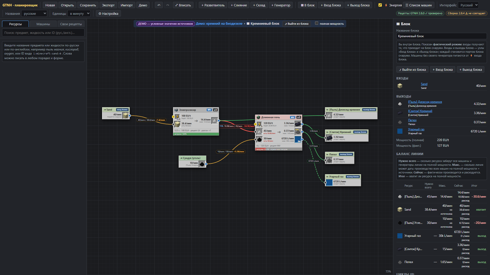

# GTNH Planner — планировщик линий

[English](README.md) · **Русский**

Планировщик производственных линий для **GregTech: New Horizons** (Minecraft 1.7.10). Собирайте
линию из настоящих рецептов GTNH на холсте, как в NEI, и смотрите на каждой связи, сколько нужно,
сколько приходит и где дефицит или избыток. Есть энергия (генераторы, кабели, потери), циклы
переработки и блоки (узел из узлов). Интерфейс на русском или английском.

Работает на вашем компьютере в браузере. В Minecraft ничего не устанавливается, файлы игры не
меняются.

Демо-схема: рецепты, генераторы и кабели — настоящие данные GTNH 2.8.0; скорости источников, число машин и длина кабелей придуманы для примера.

<table>
<tr>
<td width="33%"> Выделите узел — видно, что ему нужно, что приходит, что он производит и что его ограничивает.</td>
<td width="33%"> Блок: несколько узлов в одном, со своими входами, выходами и входом ⚡.</td>
<td width="33%"> Внутри блока: схема считается с тем, что реально приходит на входы.</td>
</tr>
</table>

---

## Установка и запуск (программировать не нужно)

### Windows

1. **Скачайте** последний `GTNH-Planner-….zip` со
   [страницы релизов](https://github.com/Jetvac/GTNH-Planner/releases/latest) и **распакуйте** в
   любую папку (например, в «Документы»).
2. **Дважды щёлкните `start.bat`.**
   - Если Python не установлен, окно предложит установить его (ответьте `Y`) или откроет
     python.org. После установки снова запустите `start.bat`.
3. Откроется браузер с планировщиком. При первом запуске появится окно **«Настройка»**:
   - **Скачать данные рецептов** (около 30 МБ, один раз). Файлы проверяются по SHA-256.
   - Выберите **язык интерфейса** и язык названий предметов.
   - По желанию: **русские названия** предметов (около 9 МБ).
   - По желанию: **папка Minecraft**. Нажмите «Найти автоматически» (Prism, MultiMC, CurseForge,
     ATLauncher…) или вставьте путь к папке, где лежат `mods` и `config`. Планировщик её только
     **читает**: версию сборки, таблицу кабелей GregTech и переводы модов.
4. Не закрывайте чёрное окно консоли, пока работаете. Закроете — планировщик остановится.

В следующий раз просто запускайте `start.bat`. Схемы сохраняются в папку `projects`.

### Linux / macOS

Установите Python 3.9+ (`sudo apt install python3`, на macOS — с python.org) и запустите
`./start.sh`. На macOS можно дважды щёлкнуть `start.command`.

### Обновление

Скачайте новый релиз, распакуйте и перенесите из старой папки `projects` (и `data/custom`, если
делали свои рецепты).

---

## Как пользоваться

| Что | Как |
|---|---|
| Найти предмет | Слева «Ресурсы»: название по-русски или по-английски, или ID. Слова в любом порядке и форме («пыль магния», «магниевая пыль»). |
| Добавить машину | Откройте предмет → «Производится» / «Потребляется» → перетащите рецепт на холст или «На холст». |
| Связать | Протяните от выхода к входу — совместимые порты подсвечиваются. Отпустите на пустом месте — появится список подходящих рецептов. |
| Число машин, уровень | Выделите узел → справа: количество, уровень машины (разгон GT учитывается), циклы/мин для особых случаев. |
| Разделить выход | Протяните вторую связь с того же выхода и задайте долю (например 70%); остальное — «авто» по потребности. |
| Энергия | Включите «⚡ Энергия», добавьте генератор, соедините его ⚡ с ⚡ машин, выберите кабель и длину. |
| Итоги линии | Справа «Баланс линии»: сколько нужно всей линии на полной мощности и сколько она может дать. «☰ Список машин» — все машины, генераторы и кабели, с копированием как текст. |
| **Блоки** | Выделите узлы (Ctrl/Shift + щелчок или Shift + рамка) → «▦ В блок» (Ctrl+G). Связи через границу станут входами и выходами блока. Двойной щелчок — открыть блок, «⤴ Выйти из блока» или Esc — назад. |
| Отмена / сохранение | Ctrl+Z / Ctrl+Y, Ctrl+S — сохранить в `projects/`. «Экспорт» — файл, которым можно поделиться. |

### Как считается

- Скорость машины `число × 20 / тиков` циклов в секунду; за каждый уровень выше рецепта — разгон GT
  (длительность ÷2, EU/t ×4; идеальный — ÷4), не короче 1 тика.
- Загрузка машины — минимальная доля «подано / нужно» по входам (и по доставленной энергии).
  Выходы с шансом — ожидаемое среднее.
- **Циклы** (Mg → Chemical Reactor → MgO → Electrolyzer → Mg) считаются в установившемся режиме:
  цикл уже заполнен, как в игре после первой загрузки. Если контур возвращает меньше, чем забирает
  (например 2 капсулы на входе, 1 на выходе), планировщик пишет, какой путь теряет, и цикл уходит
  ровно в ноль, без «хвостов» вида 1e-10.
- **Блоки** считаются точно, а не приближённо: внутренняя схема решается с тем, что реально приходит
  на входы. «Полная мощность» — сколько блок возьмёт и даст при неограниченных входах.
- **Энергия**: генератор даёт до `V × A × число` и сжигает топливо только под фактическую нагрузку.
  Энергия раздаётся по запросу, как в сети GT: машина, которой не хватает сырья, берёт меньше, и
  остаток достаётся другим. Только если генераторы не покрывают запросы машин, нехватка делится
  пропорционально. Кабель теряет `потери на блок × длину` EU на ампер; предупреждения о сгорании
  кабеля и взрыве машины.

Подробно об источниках данных и моделях — [docs/DATA.ru.md](docs/DATA.ru.md).

### Версия рецептов

Рецепты — проверенный снимок **GTNH 2.8.0**. Проверяемого экспорта для 2.8.4 нет; версия показана
в интерфейсе, при несовпадении со сборкой — предупреждение. Можно импортировать свой экспорт
(форматы 5 и 7) или вносить правки в «Свои рецепты».

---

## Для разработчиков

- Только стандартная библиотека Python 3.9+, без зависимостей; в браузере — ES-модули без сборки.
- `python planner.py --help` — параметры (`--port`, `--mc-dir`, `--no-browser`, `--fetch-data`,
  `--fetch-lang`, `--check`).
- Тесты: `python -m unittest discover -s tests` (нужны данные рецептов) и `web/tests.html` в
  запущенном планировщике (решатель).
- Структура: `server/` (HTTP API, адаптер данных, настройка, энергия, названия), `web/js/`
  (`solver.js` — расчёт, `model.js` — модель схемы, `canvas.js`, `props.js`, `i18n.js` — тексты интерфейса).

## Лицензии и благодарности

- Код планировщика — **MIT**, см. [LICENSE](LICENSE).
- Раскладка бинарного формата — из [ShadowTheAge/gtnh](https://github.com/ShadowTheAge/gtnh) (MIT, © 2025 ShadowTheAge).
- Рецепты, названия и иконки — [ShadowTheAge/gtnh-data](https://github.com/ShadowTheAge/gtnh-data).
  Без лицензии, принадлежат Mojang, команде GTNH и авторам модов, поэтому в репозиторий **не
  включены** — планировщик скачивает их из исходного репозитория на вашем компьютере.
- Русские названия — [GTNewHorizons/GTNH-Translations](https://github.com/GTNewHorizons/GTNH-Translations) (GPL-3.0), скачиваются по запросу.
- Таблица кабелей — значения из GregTech 5 Unofficial (команда GTNH, LGPL-3.0).
- На скриншотах в `docs/img` видны иконки предметов и машин Minecraft, GregTech и других модов GTNH;
  текстуры принадлежат их авторам и показаны только для иллюстрации планировщика.

Проект не связан с командой GTNH и Mojang.
